<h1 align="center">👋</h1>

  Software engineer student powered by my beloved Claude 

  
  

## Techs

  

## Most used langugaes

  

## Outside of the code

  
  

- Joueur compétitif multi-jeux : CS2, Valorant, Overwatch, LoL, Deadlock
- J'héberge les serveurs Minecraft moddés de mes potes
- Toujours en train d'optimiser quelque chose : settings, routines d'aim, configs PC